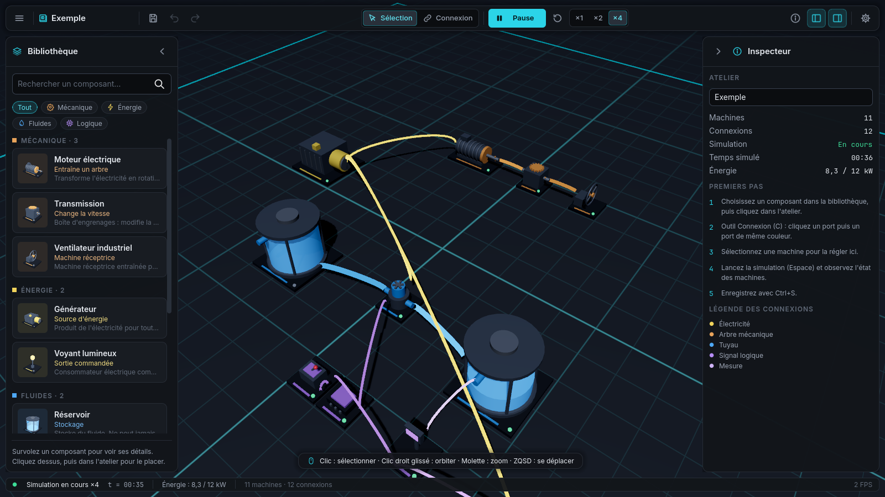

# NEXUS

Jeu PC en 3D de construction et d'expérimentation : construisez des machines, reliez-les et
combinez mécanique, énergie, fluides et automatisation. Développé avec **Godot 4.3** et **GDScript**.



**Version 0.2.0** : construction 3D et simulation jouables. Les 10 premières machines fonctionnent
réellement. Le jeu est livré sous forme d'un exécutable Windows autonome.

---

## Jouer sans installer Godot (Windows)

1. Téléchargez `NEXUS-v0.2.0-windows-x64.zip` dans les
   [Releases](https://github.com/banchetnolan2-hub/NEXUS/releases).
2. Décompressez-le n'importe où, puis lancez **`NEXUS.exe`**.

Le jeu tient dans un seul fichier, `NEXUS.exe` : les ressources sont intégrées à l'exécutable.
Il ne dépend ni de Godot, ni du dossier source, ni d'une connexion Internet.
L'exécutable n'est pas signé : si SmartScreen s'affiche, cliquez sur
**Informations complémentaires → Exécuter quand même**.

| Données | Emplacement (Windows) |
|---|---|
| Sauvegardes | `%APPDATA%\NEXUS\saves\*.nexus` |
| Paramètres | `%APPDATA%\NEXUS\settings.cfg` |
| Journaux | `%APPDATA%\NEXUS\logs\` |

Ces données ne sont pas stockées dans le dossier du jeu : vous pouvez le déplacer ou installer une
nouvelle version sans perdre vos parties.

Sans carte compatible Vulkan, lancez `NEXUS.exe --rendering-method gl_compatibility`.
Pour vérifier une installation, lancez `NEXUS.exe -- --selftest`. Cet autotest contrôle les
ressources, les paramètres et une partie d'exemple avec sauvegarde et rechargement. Le rapport est
écrit dans `%APPDATA%\NEXUS\selftest\report.txt`.

## Première partie

1. **Nouvelle partie** : choisissez un nom, puis *Atelier vide* ou *Exemple : remplissage automatique*.
2. Dans la **bibliothèque** (à gauche), cliquez sur un composant, puis dans l'atelier pour le poser.
   L'aperçu est cyan quand l'emplacement est libre, rouge sinon, et la raison s'affiche.
3. Passez en **outil Connexion** (`C`) : cliquez sur un port (sphère colorée), puis sur un port de
   la même couleur.
4. **Sélectionnez** une machine : l'inspecteur (à droite) affiche ses réglages, son état en direct
   et ses connexions.
5. **Lancez** la simulation (`Espace`) et observez les machines : voyants d'état, rotors, niveau
   des réservoirs, câbles qui s'allument quand ils transportent quelque chose.
6. **Enregistrez** (`Ctrl+S`), puis reprenez plus tard avec **Continuer**.

## Machines

| Domaine | Machine | Rôle | Réglages |
|---|---|---|---|
| Énergie | Générateur | Alimente son réseau électrique | Production maximale |
| Énergie | Voyant lumineux | Consommateur commandé par un signal | Puissance |
| Mécanique | Moteur électrique | Entraîne un arbre | Vitesse cible |
| Mécanique | Transmission | Multiplie la vitesse | Rapport |
| Mécanique | Ventilateur industriel | Machine réceptrice : charge proportionnelle à la vitesse | Charge |
| Fluides | Réservoir | Stocke du fluide (0 à la capacité) | Capacité, niveau initial, consommation |
| Fluides | Pompe | Transfère d'un réservoir à un autre ; commande par signal | Débit |
| Logique | Interrupteur | Signal manuel | Position |
| Logique | Capteur de niveau | Mesure un réservoir, signal à hystérésis | Mode, seuils |
| Logique | Porte logique | ET / OU / NON | Fonction |

Toutes les machines ont un réglage *Activé* : une machine désactivée ne consomme ni ne produit rien.

Les règles de simulation sont simples et déterministes, avec 20 pas par seconde quelle que soit la
fréquence d'affichage. La demande de chaque réseau électrique est comparée à sa production : en cas
de manque, les machines ralentissent et le signalent. Un moteur surchargé ralentit. Les réservoirs
ne dépassent jamais leur capacité et ne passent jamais sous zéro. Les connexions incompatibles sont
refusées avec une explication.

## Contrôles

| Action | Touches |
|---|---|
| Orbiter / déplacer la vue / zoomer | Clic droit glissé · clic molette glissé · molette |
| Se déplacer | `Z Q S D` (AZERTY) / `W A S D` (QWERTY) · `Maj` pour aller plus vite |
| Centrer sur la sélection | `F` |
| Sélectionner / déplacer | Clic / glisser |
| Pivoter | `R` (aperçu ou sélection) |
| Dupliquer / supprimer | `Ctrl+D` / `Suppr` |
| Annuler / rétablir | `Ctrl+Z` / `Ctrl+Y` |
| Outil Sélection / Connexion | `V` / `C` |
| Lancer, mettre en pause / réinitialiser | `Espace` / `Ctrl+R` |
| Enregistrer | `Ctrl+S` |
| Bibliothèque / inspecteur / recherche | `Ctrl+L` / `Ctrl+I` / `Ctrl+F` |
| Annuler l'action en cours, menu | `Échap` |
| Aide / plein écran | `F1` / `F11` |

## Développement

### Ouvrir le projet
Installez [Godot 4.3](https://godotengine.org/download/archive/4.3-stable/) (version standard,
pas .NET), importez `project.godot`, puis appuyez sur `F5`.
Sans éditeur : `godot --path /chemin/vers/NEXUS`.

### Tests
```bash
tools/run_tests.sh /chemin/vers/godot
```
Les 25 tests couvrent les paramètres, les sauvegardes (fichiers corrompus, migration v1, copie de
secours), la simulation (énergie, mécanique, fluides, logique), les règles de connexion, le
placement, l'annulation, l'exemple et une boucle de jeu complète pilotée à la souris et au clavier
dans l'atelier réel. Le script échoue aussi si une erreur de script apparaît dans la sortie. Les
tests sont exécutés à chaque push (`.github/workflows/ci.yml`).

### Exporter pour Windows
Le préréglage **Windows Desktop** (`export_presets.cfg`) produit un `NEXUS.exe` en Release, avec le
PCK intégré, l'icône et les informations de version.

1. Godot : **Éditeur → Gérer les modèles d'exportation → Télécharger et installer** (4.3).
2. Pour l'icône de l'exe : sous Windows, rien à faire. Sous Linux ou macOS, renseignez dans les
   paramètres de l'éditeur `Export > Windows > rcedit` (rcedit-x64.exe) et `wine`, ou décochez
   *Application > Modify Resources*.
3. **Projet → Exporter… → Windows Desktop → Exporter le projet** (sans débogage), ou en ligne de
   commande :
   ```bash
   godot --headless --path . --export-release "Windows Desktop" build/windows/NEXUS.exe
   ```
Le livrable est `build/windows/NEXUS.exe`, un fichier unique (dossier ignoré par git).

**Release automatique.** Le workflow `.github/workflows/release.yml` (tag `v*` ou lancement manuel)
exécute les tests, exporte le jeu, lance l'autotest de l'exe exporté sous Wine, puis publie le
`.zip`.

### Architecture
```
autoload/      Services : Settings, Game (session + autotest), UI (dialogues, notifications…)
simulation/    Simulation pure, sans nœud : SimWorld (placement, connexions, solveur),
               SimComponent, SimBehavior, components/*.gd (une machine = un fichier),
               NxRegistry, SimulationRunner (pas fixe)
construction/  BuildController (outils, annuler), WorldView (3D), WorkshopCamera,
               NxUndoStack, NxTemplates
components/    Visuels 3D des machines, matériaux, catalogue des catégories
scenes/        main_menu/, workshop/ (+ hud/ : barre d'outils, bibliothèque, inspecteur,
               barre d'état, aide), common/, dev/
ui/            Design system : theme/, components/ (NxDialog, NxSidePanel…), screens/
saves/         SaveManager (format versionné, écriture atomique, migrations)
tests/         run_tests.gd, workshop_loop_test.gd, export_smoke.gd (inclus dans l'export)
tools/         run_tests.sh, build_theme.gd, capture_screenshots.gd
```
Pour **ajouter une machine**, écrivez `simulation/components/ma_machine.gd`, qui déclare ses ports,
ses réglages, son état et son comportement. Ajoutez-la à `NxRegistry.TYPES` et, si vous le
souhaitez, ajoutez son modèle dans `nx_component_visual.gd`. La bibliothèque, l'inspecteur, les
connexions et les sauvegardes la prennent en charge automatiquement.

Pour le design system (palette, variantes, composants), voir
[docs/design-system.md](docs/design-system.md). Pour l'historique, voir [CHANGELOG.md](CHANGELOG.md).

## Problèmes connus
- L'exécutable Windows a été validé sous **Wine** (Linux), pas sur un vrai PC Windows. Les tests
  couvrent le rendu Vulkan (Forward+) et OpenGL, le menu, une partie complète à la souris et au
  clavier, Continuer, et les paramètres conservés après redémarrage.
- L'exécutable n'est pas signé (avertissement SmartScreen).
- Les 10 machines n'ont pas toutes un modèle détaillé : les modèles sont stylisés, en primitives.
- Pas encore de regroupement en plans réutilisables (étape 7) ni de batterie.
- Annuler/rétablir couvre les actions de construction et les réglages, pas l'état de la simulation
  (utilisez Réinitialiser).
- Polices sous licence SIL OFL : Inter et JetBrains Mono (`resources/fonts/*-LICENSE.txt`).
