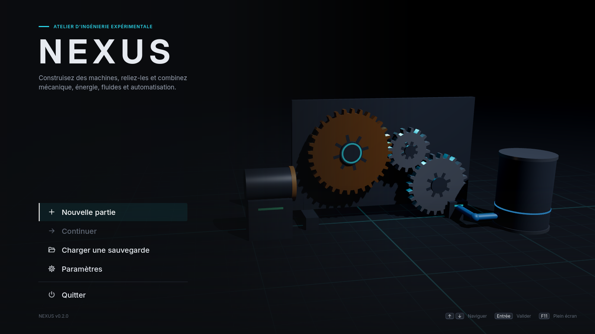

# NEXUS

Jeu PC en 3D de construction et d'expérimentation libre : le joueur construit des
machines, les relie et combine mécanique, énergie, fluides et automatisation.
Développé avec **Godot 4.3** et **GDScript**.



> **État actuel : étape 1 terminée.** Projet Godot, identité visuelle, design
> system réutilisable, menu principal, paramètres fonctionnels, et une première
> version de l'atelier (mise en page, panneaux, sauvegarde). La construction 3D
> et les machines arrivent aux étapes suivantes (voir [Feuille de route](#feuille-de-route)).

---

## Télécharger le jeu (Windows)

Les versions prêtes à jouer sont publiées dans les
[Releases GitHub](https://github.com/banchetnolan2-hub/NEXUS/releases) :
téléchargez `NEXUS-vX.Y.Z-windows-x64.zip`, décompressez-le et lancez `NEXUS.exe`
(aucune installation). L'exécutable n'est pas signé : si SmartScreen s'affiche,
cliquez sur **Informations complémentaires → Exécuter quand même**.

## Lancer le projet

1. Installez **Godot 4.3** (version standard, pas .NET) depuis
   <https://godotengine.org/download/archive/4.3-stable/>. Les versions 4.4 et
   suivantes ouvrent aussi le projet (Godot propose alors de le convertir).
2. Lancez Godot, cliquez sur **Importer**, choisissez le fichier `project.godot`
   à la racine de ce dépôt, puis **Importer et modifier**.
   Le premier import prend quelques secondes (polices, icônes).
3. Appuyez sur **F5** (ou le bouton ▶ en haut à droite) pour lancer le jeu.

Pour lancer le jeu sans ouvrir l'éditeur :

```bash
godot --path /chemin/vers/NEXUS
```

Le rendu utilise **Forward+** (Vulkan). Sur une machine sans Vulkan, lancez avec
`--rendering-method gl_compatibility`.

## Contrôles

| Où | Touche | Action |
|---|---|---|
| Partout | `F11` | Basculer plein écran / fenêtré |
| Menus | `↑` `↓` / `Tab` | Naviguer |
| Menus | `Entrée` / `Espace` | Valider |
| Fenêtres | `Échap` | Fermer la fenêtre |
| Atelier | `Échap` | Menu (reprendre, enregistrer, paramètres, quitter) |
| Atelier | `Ctrl+S` | Enregistrer l'atelier |
| Atelier | `Ctrl+L` | Afficher / réduire la bibliothèque |
| Atelier | `Ctrl+I` | Afficher / réduire l'inspecteur |

Les contrôles de caméra, de placement et de simulation seront ajoutés avec les
étapes 2 à 4.

## Ce qui fonctionne (étape 1)

- **Menu principal** animé (décor 3D d'engrenages qui s'engrènent selon leurs
  rapports de dents) : Nouvelle partie, Continuer (désactivé tant qu'aucune
  sauvegarde n'existe, affiche le nom et l'âge de la dernière), Charger,
  Paramètres, Quitter. Navigation complète au clavier.
- **Paramètres réellement appliqués et sauvegardés** (`user://settings.cfg`) :
  volume général / effets / interface, qualité graphique (4 préréglages :
  ombres, MSAA, SSAO…), mode d'affichage, résolution, synchronisation verticale,
  sensibilité et inversion de la caméra (enregistrées, utilisées à l'étape 2),
  échelle de l'interface, infobulles, réduction des animations.
- **Atelier** : vue 3D avec grille, barre d'outils, bibliothèque (recherche +
  filtre par catégorie) et inspecteur repliables, barre d'état, menu Échap,
  renommage de l'atelier, enregistrement `Ctrl+S`.
- **Sauvegardes** versionnées (JSON), écriture atomique avec vérification et
  copie `.bak` de la version précédente ; un fichier illisible est listé avec la
  raison et n'est jamais écrasé automatiquement. Suppression avec confirmation.
- **Protection des modifications** : quitter l'atelier ou fermer la fenêtre avec
  des modifications non enregistrées demande confirmation.

Captures : [atelier](docs/screenshots/workshop.png) ·
[paramètres](docs/screenshots/settings.png) ·
[menu Échap](docs/screenshots/pause_menu.png) ·
[design system](docs/screenshots/ui_gallery.png)

## Exporter pour Windows (.exe)

Un préréglage **Windows Desktop** est fourni (`export_presets.cfg`, sortie
`build/windows/NEXUS.exe`, PCK intégré à l'exécutable).

1. Dans Godot : **Éditeur → Gérer les modèles d'exportation → Télécharger et
   installer** (modèles 4.3, une seule fois).
2. **Projet → Exporter…**, sélectionnez *Windows Desktop*, puis
   **Exporter le projet** (décochez *Exporter avec débogage* pour une version finale).

En ligne de commande (modèles installés) :

```bash
godot --headless --path . --export-release "Windows Desktop" build/windows/NEXUS.exe
```

### Publication automatique

Le workflow `.github/workflows/release.yml` exporte le jeu et publie une release
GitHub avec le `.zip` Windows à chaque tag de version :

```bash
git tag v0.1.0
git push origin v0.1.0
```

> L'export de la v0.1.0 a été généré sous Linux avec les modèles officiels 4.3,
> puis lancé avec Wine : le jeu démarre et affiche le menu principal sans erreur.
> Il n'a pas encore été testé sur un vrai PC Windows. L'icône de l'exécutable
> est celle de Godot par défaut (modifier les ressources de l'exe demande `rcedit`).

## Tests

Une suite de tests sans dépendance externe vérifie les paramètres, les
sauvegardes (fichiers corrompus, versions futures, sauvegarde de secours), le
thème, les icônes, le chargement des scènes et un parcours complet piloté au
clavier (nouvelle partie → `Ctrl+S` → `Échap` → menu → Continuer).

```bash
godot --headless --path . -s res://tests/run_tests.gd
```

Le code de sortie vaut 0 si tous les tests passent.

## Architecture

```
autoload/      Services globaux : Settings, Game (session), UI (dialogues,
               notifications, transitions, infobulles, sons)
components/    Composants et leurs visuels 3D (catalogue, matériaux, engrenages)
construction/  Placement sur grille, sélection, caméra (étape 2)
simulation/    Simulation à pas fixe, indépendante de l'affichage (étapes 4–6)
saves/         SaveManager : format, lecture/écriture, migrations
scenes/        Écrans : main_menu/, workshop/, common/, dev/ (galerie UI)
ui/            Design system : theme/ (palette, générateur de thème),
               components/ (NxDialog, NxSidePanel…), screens/ (paramètres, chargement)
resources/     Polices, icônes SVG, éléments de thème, shaders, bus audio
tests/         Tests automatisés
tools/         Génération du thème, captures d'écran
docs/          Documentation et captures
```

Principes :

- **Une seule source pour le style** : `ui/theme/nx_palette.gd` (couleurs,
  espacements, tailles) → `ui/theme/nx_theme_builder.gd` → `ui/theme/nexus_theme.tres`
  (thème du projet, visible aussi dans l'éditeur). Détails dans
  [docs/design-system.md](docs/design-system.md).
- **Simulation séparée de la présentation** : les scripts de `simulation/` ne
  connaîtront ni les nœuds 3D ni l'interface.
- **Paramètres** lus via `Settings.get_value("section/clé")` et suivis avec le
  signal `Settings.setting_changed`.

Après une modification de la palette ou du générateur de thème, régénérez le thème :

```bash
godot --headless --path . -s res://tools/build_theme.gd
```

## Feuille de route

1. ✅ Projet Godot, identité visuelle et interface de base
2. Atelier 3D : caméra, grille et placement
3. Bibliothèque de composants et inspecteur
4. Connexions et première machine fonctionnelle
5. Mécanique et énergie
6. Fluides et automatisation
7. Assemblage avancé et plans
8. Sauvegardes complètes et paramètres
9. Optimisation, corrections et export Windows

## Problèmes connus

- Les boutons de simulation, Annuler et Rétablir sont visibles mais désactivés
  (une infobulle l'explique) jusqu'aux étapes concernées.
- La bibliothèque affiche les quatre catégories, encore sans composant.
- Les réglages de caméra sont enregistrés mais n'auront d'effet qu'avec la
  caméra de l'étape 2.
- Le rendu a été vérifié sous Linux (Vulkan logiciel et OpenGL) et l'exe Windows
  sous Wine, pas encore sur un vrai PC Windows.
- L'exécutable Windows n'est pas signé et utilise l'icône Godot par défaut.
- Polices sous licence SIL OFL : Inter et JetBrains Mono
  (`resources/fonts/*-LICENSE.txt`).
