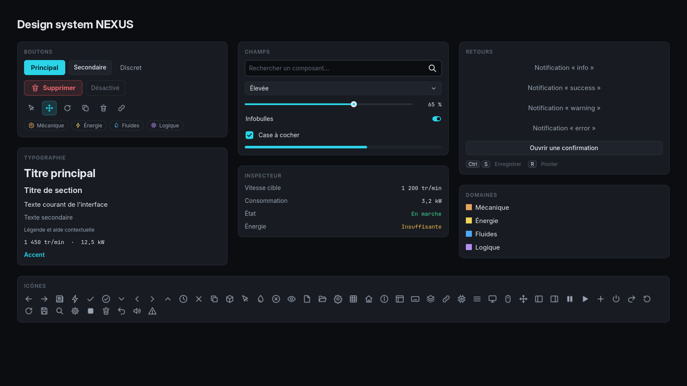

# Design system NEXUS

Toute l'interface suit un seul système. Pour le voir en entier, lancez la scène
`scenes/dev/ui_gallery.tscn` (F6 dans l'éditeur).



## Principes

- **Sombre et calme** : surfaces graphite légèrement bleutées, peu de bordures.
- **Un seul accent** : cyan électrique `#2BD4E8`, réservé à l'état actif, au focus
  clavier, aux actions principales et aux éléments lumineux importants en 3D.
- **Couleurs de domaine** discrètes (pastilles, icônes) : Mécanique `#E8A35A`,
  Énergie `#F0D35B`, Fluides `#4EA8F5`, Logique `#B58CF5`.
- **Lisibilité** : texte courant 15 px, jamais sous 12 px ; valeurs numériques en
  police à chasse fixe.
- **Animations courtes** (120–350 ms), jamais bloquantes, désactivables
  (Paramètres → Interface → Réduire les animations).

## Jetons (`ui/theme/nx_palette.gd`)

| Jeton | Valeur | Usage |
|---|---|---|
| `BG_0` | `#0B0D10` | Fond de l'application, champs de saisie |
| `BG_1` | `#12151A` | Panneaux, barres |
| `BG_2` | `#181C22` | Cartes |
| `BG_3` | `#1F242C` | Boutons secondaires, survol |
| `BG_4` | `#29303A` | Pressé |
| `TEXT` / `TEXT_MUTED` / `TEXT_DIM` | `#E6EAF0` / `#9AA3B2` / `#5F6876` | Hiérarchie du texte |
| `SUCCESS` / `WARNING` / `DANGER` | `#3DDC97` / `#F2B84B` / `#F2545B` | États |
| Espacements | 4 · 8 · 12 · 16 · 24 · 32 | Marges et écarts |
| Rayons | 4 · 6 · 10 | Coins |

Polices : **Inter** (interface), **Inter Display Bold** (titres, logotype),
**JetBrains Mono** (valeurs).

## Variantes de thème

Appliquées avec la propriété `theme_type_variation` d'un contrôle.

| Type | Variantes |
|---|---|
| Button | `PrimaryButton`, *(défaut = secondaire)*, `GhostButton`, `DangerButton`, `ToolButton` (icône seule), `MenuEntryButton` (menu principal), `NavButton` (navigation verticale, listes), `ChipButton` (filtres), `LibraryCard` (carte cliquable de bibliothèque / modèle), `SegmentButton` (outils, vitesse), `PlayButton` (lancer la simulation) |
| PanelContainer | `Card`, `InsetPanel`, `SidePanel`, `BarPanel`, `DialogPanel`, `ToastPanel`, `KeyCap`, `Pill` (pastille d'état), `SegmentGroup` (groupe de segments), `HintPanel` (bulle d'aide de l'atelier) |
| Label | `Wordmark`, `Headline`, `TitleLabel`, `SectionLabel` (à utiliser avec `uppercase`), `MutedLabel`, `DimLabel`, `CaptionLabel`, `ValueLabel`, `AccentLabel` |

## Composants réutilisables (`ui/components/`)

| Classe | Rôle |
|---|---|
| `NxDialog` | Fenêtre modale : titre, contenu, boutons ; focus clavier piégé, `Échap` pour fermer |
| `NxSidePanel` | Panneau latéral repliable en bande fine |
| `NxSettingRow` | Ligne de réglage : titre + description à gauche, contrôle à droite |
| `NxSliderField` | Curseur avec valeur affichée |
| `NxPropertyRow` | Ligne « nom … valeur » des inspecteurs |
| `NxEmptyState` | Message centré quand une liste est vide |
| `NxKeyHint` | Touches de raccourci affichées comme des touches de clavier |
| `NxIcons` | Accès aux icônes (`NxIcons.get_icon("save")`) |
| `NxThumbnails` | Miniatures 3D des machines, rendues une fois hors écran |
| `NxHud` | Petits constructeurs du HUD : boutons d'outil, badges de domaine, pastilles d'état |

## États des machines

Une seule correspondance couleur ↔ état, partout (voyant 3D, pastille de l'inspecteur) :
en marche = vert `SUCCESS`, avertissement (énergie insuffisante, surcharge, source vide) = ambre
`WARNING`, erreur (non alimenté, non relié) = rouge `DANGER`, à l'arrêt = gris, désactivé = gris
foncé. Les connexions prennent la couleur de leur type (électricité jaune, arbre cuivre, tuyau
bleu, signal violet, mesure violet clair) et s'illuminent quand elles transportent quelque chose.

Services de l'autoload `UI` :

```gdscript
UI.open_dialog(dialog)                                   # Ouvre un NxDialog
UI.confirm(titre, message, "Supprimer", callback)        # Actions destructrices uniquement
UI.show_error(titre, message)                            # Erreur expliquée
UI.toast("Atelier enregistré.", &"success")              # Notification
UI.set_tooltip(control, "Texte")                         # Respecte le réglage « Infobulles »
UI.change_scene(path)                                    # Transition en fondu
UI.anim_time(0.2)                                        # Durée respectant « Réduire les animations »
```

## Icônes

`resources/icons/*.svg` : grille 24 px, trait blanc de 1,75 px, extrémités
arrondies. La couleur vient du thème (couleurs d'icônes des boutons) ou de
`modulate`. Pour ajouter une icône, créez un SVG dans le même style ;
`NxIcons.list_icons()` la trouvera automatiquement.

## 3D

- `NxStudioEnvironment` : éclairage commun (fond uni, ciel sombre pour les
  reflets, brouillard, lueur réservée aux surfaces émissives) qui suit la qualité
  graphique choisie.
- `NxMaterials` : acier, métal usiné, peinture de domaine, lumière d'état, sol en grille.
- La lueur cyan est réservée aux éléments importants (états, connexions actives).
